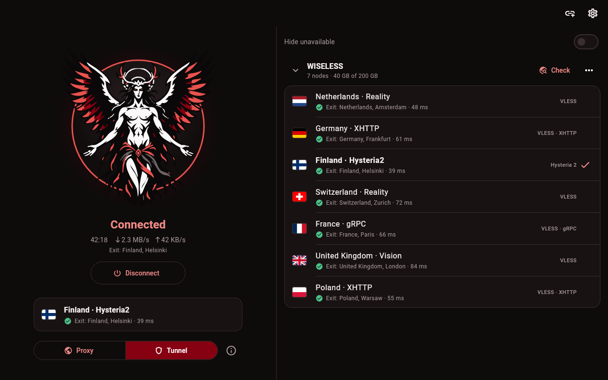
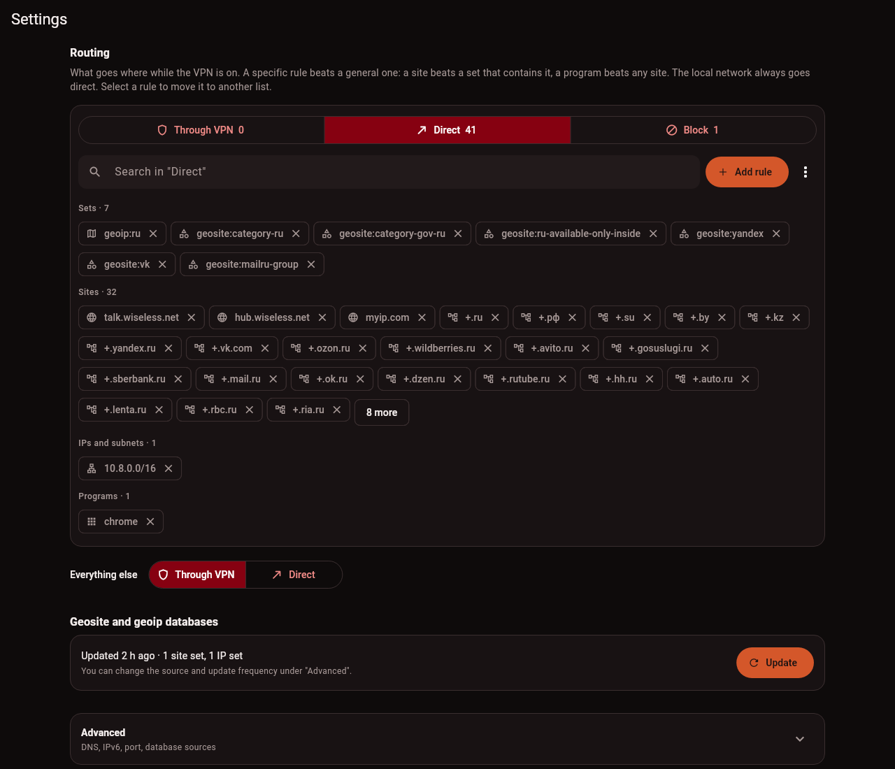

<p align="center">
  
</p>

<h1 align="center">Crocell</h1>

<p align="center">
  A proxy and tunnel client you don't have to study first.<br>
  Linux · Windows · macOS · Android<br>
  VLESS Reality · XHTTP · VMess · Trojan · Shadowsocks · Hysteria2 · TUIC · WireGuard · AmneziaWG
</p>

<p align="center">
  <b>English</b> &nbsp;|&nbsp; <a href="README.ru.md">Русский</a>
</p>

<p align="center">
  <a href="https://github.com/WiselessGroup/Crocell/releases/latest"></a>
  <a href="https://github.com/WiselessGroup/Crocell/releases"></a>
  <a href="https://github.com/WiselessGroup/Crocell/actions/workflows/build.yml"></a>
  <a href="https://github.com/WiselessGroup/Crocell/commits/master"></a>
  <a href="https://github.com/WiselessGroup/Crocell/stargazers"></a>
  <a href="LICENSE"></a>
</p>

<p align="center">
  
</p>

Paste your subscription link, pick a node, press the button. That's the whole first screen. No wall of toggles, no "ping 5000" that means nothing to anyone.

Under the hood it's [mihomo](https://github.com/MetaCubeX/mihomo), so it speaks every modern protocol. On top of that it does the things I kept missing in other clients: it shows where a node really exits, it checks that traffic actually goes through the node (and tells you when it stops), and it lets you send a site or a program around the tunnel without editing YAML.

It's free and open source, with no accounts, no ads and no telemetry. Crocell is only the client, so you bring a subscription from your provider or a server of your own.

## Download

| System | File |
|---|---|
| Linux, x86_64 | [Crocell-x86_64.AppImage](https://github.com/WiselessGroup/Crocell/releases/latest/download/Crocell-x86_64.AppImage) |
| Windows 10 / 11, x64 | [Crocell-x86_64-Setup.exe](https://github.com/WiselessGroup/Crocell/releases/latest/download/Crocell-x86_64-Setup.exe) |
| macOS, Apple silicon | [Crocell-arm64.dmg](https://github.com/WiselessGroup/Crocell/releases/latest/download/Crocell-arm64.dmg) |
| Android 7+ | [Crocell.apk](https://github.com/WiselessGroup/Crocell/releases/latest/download/Crocell.apk) |

When a new version comes out, Crocell says so after you connect, and a click on the notice shows how to update on your system. The app speaks English or Russian, whichever your system does.

### First start

On a desktop the connection is held by a small system service, so closing or updating the window never drops it. The service needs admin rights once:

- **Linux.** Crocell shows the install command and a copy button. If [Gear Lever](https://flathub.org/apps/it.mijorus.gearlever) keeps the AppImage, it's `sudo ~/AppImages/crocell.appimage crocelld install`. Gear Lever also picks up updates by itself.
- **Windows.** The installer sets the service up. The build isn't code-signed yet, so SmartScreen will warn you: "More info", then "Run anyway".
- **macOS.** Drag Crocell to Applications. It isn't notarized, so macOS blocks the first launch; allow it in System Settings → Privacy & Security → "Open Anyway". Then press "Install service" in Crocell and enter your password.
- **Android.** Let your browser install the APK, then allow the connection when Android asks. That's it, there's no service to install.

## What it does

- Takes subscriptions in any shape: `vless://`, `vmess://`, `trojan://`, `ss://`, `hysteria2://`, `tuic://` links, base64 of them, or Clash/mihomo YAML with `proxy-providers`. It figures out the format itself and reads the title, traffic and expiry the provider sends.
- Takes WireGuard and AmneziaWG too: paste a config, an `awg://` link or a `vpn://` key from AmneziaVPN.
- Handles VLESS Reality and Vision, XHTTP, Hysteria2 with obfs, and the rest of what mihomo supports.
- Shows each node as a flag and an exit city after a check, not as a latency number. If the name says Netherlands and the exit says Germany, you'll see that. Nodes that failed their check can be hidden with one switch.
- Runs as a system proxy (no admin rights, for apps that respect it) or as a TUN tunnel for the whole system. On Android the same choice means the whole phone through the tunnel, or a local proxy for the apps you point at it.
- Routes traffic through three lists: through the tunnel, direct, or blocked. A rule can be a site, a wildcard, a subnet, a [runetfreedom](https://github.com/runetfreedom/russia-v2ray-rules-dat) geosite/geoip set (or your own database), a program, or an Android app. Lists copied from v2ray configs paste as they are, `domain:` and `full:` included. A specific rule beats a general one.
- Checks the connection right after connecting and every couple of minutes, and sends a notification if traffic stops getting through.
- Picks up new settings on its own: change a rule while connected and the tunnel quietly reconnects.
- Turns on and off without opening the window: a Quick Settings tile on Android, and a toggle in GNOME's quick settings (Settings → "Add to GNOME quick settings" installs it).
- Lets you pick the picture on the button and, on Windows and Android, the app icon with its background. macOS picks between two and follows the system's light or dark look.
- Copies its logs with one button, subscription links taken out, for when something breaks and you want to [tell us](https://github.com/WiselessGroup/Crocell/issues/new/choose).
- Keeps subscriptions and settings encrypted with AES-256-GCM. On Linux the key is sealed with `systemd-creds` (TPM when there is one), on Android it sits in the Keystore. A copied state file is useless anywhere else.

<p align="center">
  
</p>

## Questions

**Does it come with servers?** No. Crocell has no servers and sells nothing. You need a subscription or a config from a provider, or your own server.

**Will it read my provider's subscription?** If it's V2Ray/Xray links, base64 of them or Clash/mihomo YAML, it should. If it doesn't, [tell us](https://github.com/WiselessGroup/Crocell/issues/new?template=bug_report.yml), but keep the link itself to yourself: it works like a password.

**What does the app connect to on its own?** Here's the whole list:

- the subscription links you added;
- Cloudflare's trace page, through the node, to see where that node exits. If you let it pick the node by itself, also every few minutes through each node of the subscription while the tunnel is in use;
- the DNS servers from Settings, through the tunnel (1.1.1.1 and 8.8.8.8 unless you change them);
- GitHub, for the update check and the geosite/geoip databases.

## How it's built

```
app/              Flutter client: the interface, no protocol code
core/             Go core on top of mihomo: subscriptions, checks, the tunnel
  cmd/crocelld    the desktop service that holds the tunnel
  cmd/crocell     a CLI for development and debugging
  mobile          the core as an Android library (gomobile)
  third_party/    mihomo with our fixes, see its CROCELL.md
proto/            the API between the client and the core
```

On desktops the client talks to `crocelld` over a local socket (loopback with a token on Windows, where Dart has no unix sockets). On Android the same core runs inside the app, and Android's tunnel API builds the interface it asks for.

## Building from source

You need Go 1.26+ and Flutter 3.47+.

```bash
cd core
make test
go run ./cmd/crocell nodes 'https://example.com/sub/…'
go run ./cmd/crocell up 'https://example.com/sub/…' --node 'nlWISELESS'
```

`crocell up` starts a mixed proxy on `127.0.0.1:7890` through the chosen node, which is handy for poking at the core without the app. Add `-sysproxy` to point the system proxy at it, or build with `make build` and run `sudo bin/crocell up … -tun` to send the whole system through it.

To run the app against a service on your machine:

```bash
cd core && make install-daemon     # Linux: installs and starts crocelld
cd ../app && flutter run -d linux
```

`CROCELL_SOCKET=/path/to/crocelld.sock` points the client at a service you started by hand. After changing `proto/`, run `make proto` in `core/` (needs `dart pub global activate protoc_plugin`).

The packages come out of `scripts/`: `build-appimage.sh`, `build-windows.sh`, `build-macos.sh` and `build-android.sh`, each taking a version.

## Contributing

Bug reports help the most, especially for subscriptions and networks I can't test myself. [CONTRIBUTING.md](CONTRIBUTING.md) has the setup and the rules, [AGENTS.md](AGENTS.md) is for coding agents, and vulnerabilities go through [SECURITY.md](SECURITY.md).

If Crocell saved you from editing a YAML file, a star helps other people find it.

## The author's pledge

I, fureunoir, the creator of Crocell, give my word that Crocell will never be paid software for anyone, individuals or companies. It will have no subscriptions and no paid features. The GPL-3.0 allows third parties to sell their own builds; I bear no responsibility for those.

I hold that no word should be banned. I condemn insults directed at governments, people with disabilities, believers and any other group. But a kitchen knife can also do harm, and knives are not taken away from everyone because of it: the person who did the harm answers for it. I believe the same approach applies to access to the Internet, and that the task of any country's government is to bring up its citizens to a cultural level at which restricting the Internet is unnecessary.

This is my personal opinion, not a call to action. I do not urge anyone to break the laws of any country: each user is responsible for complying with them where they are.

I do not hide my identity, and I demand that Crocell not be used for evil: terrorism, human trafficking, gambling or similar activity. The license does not allow me to make this a legal restriction, so it stands as my personal demand of everyone who runs this program.

fureunoir

## License

[GPL-3.0](LICENSE).
