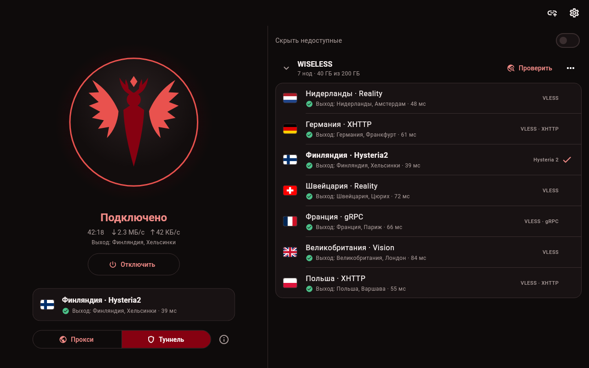
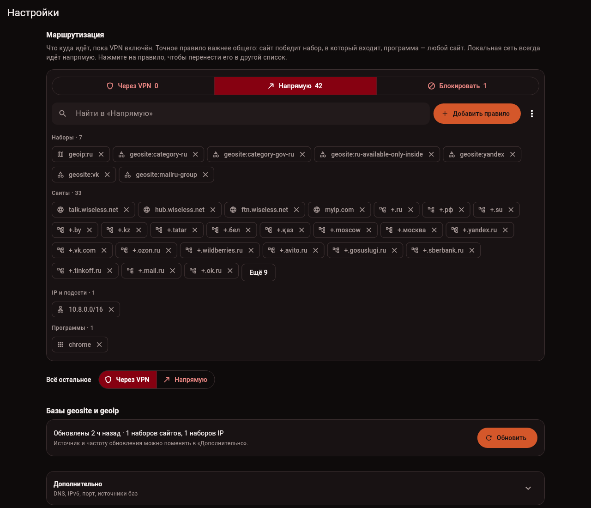

<p align="center">
  
</p>

<h1 align="center">Crocell</h1>

<p align="center">
  Клиент для прокси и туннелей, который не нужно сначала изучать.<br>
  Linux · Windows · macOS · Android<br>
  VLESS Reality · XHTTP · VMess · Trojan · Shadowsocks · Hysteria2 · TUIC · WireGuard · AmneziaWG
</p>

<p align="center">
  <a href="README.md">English</a> &nbsp;|&nbsp; <b>Русский</b>
</p>

<p align="center">
  <a href="https://github.com/WiselessGroup/Crocell/releases/latest"></a>
  <a href="https://github.com/WiselessGroup/Crocell/releases"></a>
  <a href="https://github.com/WiselessGroup/Crocell/actions/workflows/build.yml"></a>
  <a href="https://github.com/WiselessGroup/Crocell/commits/master"></a>
  <a href="https://github.com/WiselessGroup/Crocell/stargazers"></a>
  <a href="LICENSE"></a>
</p>

<p align="center">
  
</p>

Вставил ссылку на подписку, выбрал ноду, нажал кнопку. Это весь первый экран. Без простыни переключателей и без «пинг 5000», который никому ничего не говорит.

Внутри [mihomo](https://github.com/MetaCubeX/mihomo), так что все современные протоколы на месте. Сверху то, чего мне не хватало в других клиентах: видно, где у ноды на самом деле выход; Crocell проверяет, что трафик правда идёт через ноду, и говорит, когда перестал; сайт или программу можно пустить мимо туннеля без правки YAML.

Crocell бесплатный и с открытым кодом, без аккаунтов, рекламы и телеметрии. Это только клиент: подписку даёт ваш провайдер, а можно подключить и свой сервер.

## Скачать

| Система | Файл |
|---|---|
| Linux, x86_64 | [Crocell-x86_64.AppImage](https://github.com/WiselessGroup/Crocell/releases/latest/download/Crocell-x86_64.AppImage) |
| Windows 10 / 11, x64 | [Crocell-x86_64-Setup.exe](https://github.com/WiselessGroup/Crocell/releases/latest/download/Crocell-x86_64-Setup.exe) |
| macOS, Apple silicon | [Crocell-arm64.dmg](https://github.com/WiselessGroup/Crocell/releases/latest/download/Crocell-arm64.dmg) |
| Android 7+ | [Crocell.apk](https://github.com/WiselessGroup/Crocell/releases/latest/download/Crocell.apk) |

Когда выходит новая версия, Crocell сообщает об этом после подключения, а по клику на уведомление показывает, как обновиться именно на вашей системе. Язык интерфейса, русский или английский, берётся из системы.

### Первый запуск

На компьютере соединение держит маленькая системная служба: закрыли или обновили окно, а связь не моргнула. Права администратора ей нужны один раз:

- **Linux.** Crocell покажет команду установки и кнопку «скопировать». Если AppImage живёт в [Gear Lever](https://flathub.org/apps/it.mijorus.gearlever), команда такая: `sudo ~/AppImages/crocell.appimage crocelld install`. Обновления Gear Lever подтягивает сам.
- **Windows.** Службу ставит установщик. Сборка пока без цифровой подписи, поэтому SmartScreen предупредит: «Подробнее», затем «Выполнить в любом случае».
- **macOS.** Перетащите Crocell в «Программы». Приложение не нотаризовано, и первый запуск macOS заблокирует: разрешите его в «Системные настройки» → «Конфиденциальность и безопасность» → «Всё равно открыть». Потом нажмите в Crocell «Установить службу» и введите пароль.
- **Android.** Разрешите браузеру установить APK, а потом разрешите подключение, когда Android спросит. Больше ничего ставить не надо.

## Что умеет

- Читает подписки любого вида: ссылки `vless://`, `vmess://`, `trojan://`, `ss://`, `hysteria2://`, `tuic://`, base64 от них, Clash/mihomo YAML с `proxy-providers`. Формат определяет сам, название, трафик и срок берёт из того, что присылает провайдер.
- Принимает WireGuard и AmneziaWG: вставьте конфиг, ссылку `awg://` или ключ `vpn://` из AmneziaVPN.
- Работает с VLESS Reality и Vision, XHTTP, Hysteria2 с obfs и всем остальным, что умеет mihomo.
- Показывает ноду флагом и городом выхода после проверки, а не цифрой задержки. Если в названии Нидерланды, а выход в Германии, вы это увидите. Ноды, не прошедшие проверку, можно спрятать одним переключателем.
- Подключается системным прокси (без прав администратора, для программ, которые его слушаются) или туннелем TUN для всей системы. На Android тот же выбор означает весь телефон через туннель или локальный прокси для приложений, где вы его указали.
- Раскладывает трафик по трём спискам: через туннель, напрямую, блокировать. Правило может быть сайтом, маской, подсетью, набором geosite/geoip из баз [runetfreedom](https://github.com/runetfreedom/russia-v2ray-rules-dat) (или своих), программой или приложением на Android. Списки из конфигов v2ray вставляются как есть, с `domain:` и `full:`. Точное правило важнее общего.
- Проверяет соединение сразу после подключения и потом раз в пару минут, а если трафик перестал проходить, присылает уведомление.
- Сам подхватывает новые настройки: поменяли правило при включённом туннеле, и он тихо переподключился.
- Включается и выключается, не открывая окна: плитка в шторке Android и переключатель в быстрых настройках GNOME (ставится из настроек кнопкой «Добавить в быстрые настройки GNOME»).
- Даёт выбрать картинку на кнопке, а на Windows и Android ещё и иконку приложения с фоном. На macOS выбор из двух, и значок сам следует за светлой или тёмной темой.
- Копирует свои логи одной кнопкой, без ссылок на подписки: если что-то сломалось и хочется [рассказать нам](https://github.com/WiselessGroup/Crocell/issues/new/choose).
- Хранит подписки и настройки зашифрованными в AES-256-GCM. На Linux ключ запечатан через `systemd-creds` (с TPM, если он есть), на Android лежит в Keystore. Скопированный файл состояния на другой машине бесполезен.

<p align="center">
  
</p>

## Вопросы

**Серверы в комплекте есть?** Нет. У Crocell нет серверов, и он ничего не продаёт. Нужна подписка или конфиг от провайдера либо свой сервер.

**Прочитает ли он подписку моего провайдера?** Если это ссылки V2Ray/Xray, base64 от них или Clash/mihomo YAML, должен. Если не прочитал, [напишите нам](https://github.com/WiselessGroup/Crocell/issues/new?template=bug_report.yml), только саму ссылку не публикуйте: она работает как пароль.

**Куда приложение ходит само?** Вот весь список:

- по ссылкам на подписки, которые вы добавили;
- на страницу trace у Cloudflare, через ноду, чтобы узнать, где у неё выход. Если разрешить выбирать ноду самому, то ещё и раз в несколько минут через каждую ноду подписки, пока туннелем пользуются;
- к DNS-серверам из настроек, через туннель (1.1.1.1 и 8.8.8.8, если не меняли);
- на GitHub, за проверкой обновлений и базами geosite/geoip.

## Как устроено

```
app/              клиент на Flutter: интерфейс, никакой логики протоколов
core/             ядро на Go поверх mihomo: подписки, проверки, туннель
  cmd/crocelld    служба, которая держит туннель на компьютере
  cmd/crocell     CLI для разработки и отладки
  mobile          ядро как библиотека для Android (gomobile)
  third_party/    mihomo с нашими исправлениями, подробности в его CROCELL.md
proto/            контракт клиента и ядра
```

На компьютере клиент говорит с `crocelld` через локальный сокет (на Windows через loopback с токеном: там у Dart нет unix-сокетов). На Android то же ядро работает внутри приложения, а интерфейс для него строит системный API туннелей Android.

## Сборка из исходников

Нужны Go 1.26+ и Flutter 3.47+.

```bash
cd core
make test
go run ./cmd/crocell nodes 'https://example.com/sub/…'
go run ./cmd/crocell up 'https://example.com/sub/…' --node 'nlWISELESS'
```

`crocell up` поднимает mixed-прокси на `127.0.0.1:7890` через выбранную ноду: удобно ковырять ядро без приложения. С `-sysproxy` он пропишет системный прокси, а после `make build` команда `sudo bin/crocell up … -tun` пустит через ноду всю систему.

Запустить приложение со службой на своей машине:

```bash
cd core && make install-daemon     # Linux: ставит и запускает crocelld
cd ../app && flutter run -d linux
```

`CROCELL_SOCKET=/путь/к/crocelld.sock` направит клиент на службу, запущенную руками. После правок в `proto/` выполните `make proto` в `core/` (нужен `dart pub global activate protoc_plugin`).

Пакеты собирают скрипты в `scripts/`: `build-appimage.sh`, `build-windows.sh`, `build-macos.sh` и `build-android.sh`, каждый принимает версию.

## Как помочь

Больше всего помогают отчёты об ошибках, особенно по подпискам и сетям, которые я сам проверить не могу. Настройка окружения и правила описаны в [CONTRIBUTING.ru.md](CONTRIBUTING.ru.md), инструкции для кодинг-агентов в [AGENTS.md](AGENTS.md), а про уязвимости написано в [SECURITY.md](SECURITY.md).

Если Crocell избавил вас от правки YAML, поставьте звезду: так его проще найти другим.

## Обязательство автора

Я, fureunoir, создатель Crocell, даю слово, что Crocell никогда не будет платным ни для кого: ни для людей, ни для компаний. В нём не будет подписок и платных функций. Лицензия GPL-3.0 разрешает третьим лицам продавать собственные сборки; за них я ответственности не несу.

Я убеждён, что ни одно слово не должно быть запрещено. Я осуждаю оскорбления правительств, людей с инвалидностью, верующих и любых других групп. Но кухонным ножом тоже можно причинить вред, и ножи при этом не изымают у всех: отвечает тот, кто причинил вред. Я считаю, что к доступу в Интернет применим тот же подход, а задача правительства любой страны состоит в том, чтобы воспитывать граждан на таком культурном уровне, при котором ограничивать Интернет не приходится.

Это моё личное мнение, а не призыв к действию. Я не призываю нарушать законы какой-либо страны: каждый пользователь сам отвечает за их соблюдение там, где находится.

Я не скрываю своей личности и требую не использовать Crocell во зло: для терроризма, торговли людьми, азартных игр и подобной деятельности. Лицензия не позволяет закрепить этот запрет юридически, поэтому он остаётся моим личным требованием к каждому, кто запускает эту программу.

fureunoir

## Лицензия

[GPL-3.0](LICENSE).
